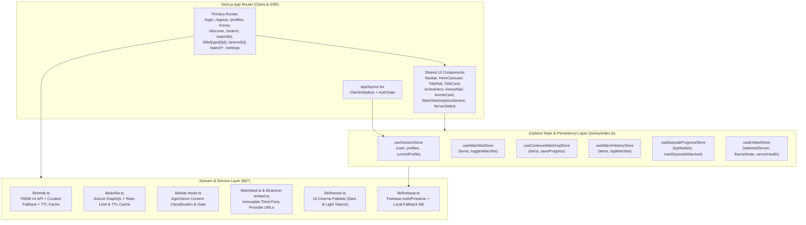

# Zoku TV — Architecture & Dependency Map

## 1. High-Level System Architecture

---

## 2. Feature-to-Component & Store Dependency Map

| Feature Area | Primary Route(s) | Controlling Components | Controlling Stores & Domain Modules |
| :--- | :--- | :--- | :--- |
| **Authentication & Route Guarding** | `/`, `/login`, `/signup` | `AuthGate.tsx`, `ClientInitializer.tsx`, `BrandShell.tsx`, `FirebaseStatusIndicator.tsx` | `useSessionStore`, `lib/firebase.ts`, `lib/auth-routes.ts` |
| **Profile Management & Isolation** | `/profiles` | `ProfileAvatarDisplay.tsx`, `AvatarPicker.tsx`, `Toast.tsx`, `LoadingBanner.tsx` | `useSessionStore`, `lib/profile-avatars.ts`, `lib/profile-limits.ts` |
| **Theme & Appearance System** | `/settings?section=theme`, all routes | `ClientInitializer.tsx`, `SettingsPage` | `useSessionStore` (`themePreference`, `appearancePreference`), `lib/themes.ts`, `app/globals.css` |
| **Homepage & Catalog Rails** | `/home` | `Navbar.tsx`, `HeroCarousel.tsx`, `TitleRail.tsx`, `TitleCard.tsx`, `ContinueWatchingRail.tsx`, `WatchHistoryRail.tsx`, `AnimeHero.tsx`, `AnimeRail.tsx`, `AnimeCard.tsx` | `useSessionStore`, `useRailFilterStore`, `useWatchlistStore`, `useContinueWatchingStore`, `useWatchHistoryStore`, `lib/tmdb.ts`, `lib/anilist.ts`, `lib/kids-mode.ts` |
| **Discovery & Genre Feeds** | `/discover`, `/genre/[id]` | `DiscoverPage`, `AnimeDiscover.tsx`, `GenrePage`, `CustomSelect.tsx` | `useSessionStore`, `lib/tmdb.ts`, `lib/anilist.ts`, `lib/kids-mode.ts` |
| **Unified Search, Autocomplete & Voice** | `/search` | `SearchPage`, `SearchAutocompleteDropdown.tsx`, `VoiceSearchButton.tsx` | `useSessionStore`, `lib/autocomplete.ts`, `lib/search-history.ts`, `lib/kids-mode.ts` |
| **Media Details & Episode Guide** | `/title/[type]/[id]`, `/anime/[id]` | `TitleDetailsPage`, `AnimeDetailPage`, `TrailerModal.tsx`, `TitleRail.tsx`, `AnimeRail.tsx` | `useSessionStore`, `useWatchlistStore`, `useContinueWatchingStore`, `useEpisodeProgressStore`, `lib/tmdb.ts`, `lib/anilist.ts`, `lib/kids-mode.ts` |
| **Watchlist Search & D3 Analytics** | `/watchlist` | `WatchlistPage`, `WatchlistAnalyticsSection.tsx`, `TitleCard.tsx`, `AnimeCard.tsx` | `useWatchlistStore`, `lib/watchlist.ts` (`filterWatchlistItems`, `computeWatchlistAnalytics`) |
| **External Player Container & Progress** | `/watch/[type]/[id]`, `/watch/[type]/[id]/[season]/[episode]`, `/watch/anime/[anilistId]/[season]/[episode]` | `ServerSelect.tsx`, `ResumePrompt.tsx` | `useEmbedStore`, `useContinueWatchingStore`, `useWatchHistoryStore`, `useEpisodeProgressStore`, `hooks/useWatchProgress.ts`, `hooks/useAnimeWatchProgress.ts`, `lib/embed.ts`, `lib/anime-embed.ts`, `lib/player-progress.ts` |
| **PWA & Offline Resilience** | All routes | `ClientInitializer.tsx`, `Navbar.tsx` | `public/sw.js`, `public/manifest.json`, `lib/network-status.ts`, `lib/runtime-guards.ts` |

---

## 3. Data Persistence Hierarchy

All profile-owned data is strictly scoped under the authenticated user ID (`uid`) and active profile ID (`profileId`):

- **Firestore Path Structure**:
  - `users/{uid}/profiles/{profileId}`
  - `users/{uid}/profiles/{profileId}/watchlist/{docId}`
  - `users/{uid}/profiles/{profileId}/continueWatching/{docId}`
  - `users/{uid}/profiles/{profileId}/watchHistory/{docId}`
  - `users/{uid}/profiles/{profileId}/episodeProgress/{docId}`
- **LocalStorage Keys**:
  - `zoku-session-storage` (Zustand session store: active profile, profiles cache)
  - `zoku-embed-storage` (Zustand embed store: selected server, sandbox mode, provider status)
  - `zoku_search_history_{uid}_{profileId}` (Profile-isolated recent search queries)
  - `zoku_tmdb_cache_*` & `zoku_anilist_cache_*` (Public catalog metadata cache with TTL)

